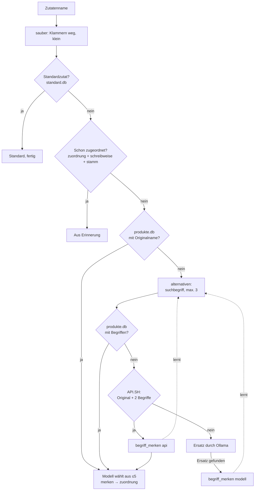

# Recipe-to-REWE (lokal, privat, 0 €)

## Starten
1. Python 3 und Ollama installieren, ein Modell laden (`ollama pull <Modellname>`), Ollama starten. Kontextlänge in Ollama mindestens 8k.
2. Optional (Marktsuche, Produktzuordnung = Stufe 2): Konto bei https://app.api.sh/signup, API-Schlüssel erzeugen. Laut Anbieter gibt es monatlich 1.000 kostenlose Credits.
   **Kein Zahlungsmittel hinterlegen**, nichts aufladen, Ausgabenobergrenze („Spend limits“) auf 0 setzen, falls angeboten.
3. `.env.example` in `.env` umbenennen (Windows: Dateiendungen einblenden), Schlüssel eintragen: `APISH_KEY=dein-schluessel`. Nie weitergeben.
4. `python start.py` ausführen und http://127.0.0.1:8000 öffnen. (`python start.py --ohne-neustart` oder `python server.py` starten ohne Neustart-Automatik.)

## Aufbau: warum kleine Änderungen nur eine Datei betreffen
```
start.py        startet den Server und startet ihn bei Änderungen an den Python-Dateien automatisch neu
server.py       Einstiegspunkt
rtr/            Programmlogik in kleinen Modulen
  config.py       Pfade, Einstellungen, API-Schlüssel
  protokoll.py    Protokoll für /status
  modell.py       lokales Modell (Ollama): Datenstrom, Geduld, Fehlermeldungen
  rezept.py       Rezept auslesen, Mengen, Ersatz, Links zum Ersatz
  apish.py        API.SH: Marktsuche, Produktsuche, Produktdetails
  standard.py     Standardzutaten (standard.db)
  woerter.py      Wortdatenbank (woerter.db): Schreibweisen, Suchbegriffe, Zutat → Produkt
  datenbank.py    SQLite-Datenbank, Standardzutaten, Datenbankseite, CSV
  hellofresh.py   HelloFresh-Seite laden
  web.py          Webserver mit allen Routen
prompts/        Anweisungen an das Modell als Textdateien (extrahieren, ersatz, auswahl)
static/         Seiten: je Seite .html, .css und .js (index = Hauptseite, status, datenbank)
```
Was wann gilt, ohne alles neu zu laden:
- **Seiten** (`static/`) und **Prompts** (`prompts/`) werden bei jedem Aufruf neu gelesen: Datei tauschen, Browser-Seite neu laden. Kein Neustart.
- **Python-Dateien** (`rtr/*.py`): mit `python start.py` erkennt das Programm die Änderung und startet den Server selbst neu. Ist eine Datei kaputt, wartet es,
  bis sie repariert ist. Die Seiten zeigen dann unten einen Hinweis „Neue Programmversion verfügbar“ mit Button zum Neuladen (die Seite lädt nicht von selbst neu, damit nichts verloren geht).
- **Einstellungen** (`settings.json`) und der **API-Schlüssel** (`.env`) gelten sofort.
- **Daten** (`produkte.db`, `settings.json`, `.env`, `credits.json`, `cache.json`) liegen im Programmordner und werden von Updates nie überschrieben.

### Updates einspielen
Künftig genügt es, nur die genannten Dateien in den Ordner zu kopieren (gleicher Pfad, z. B. `static/index.js` oder `rtr/rezept.py`), alles andere bleibt.
**Einmalige Umstellung** von der alten Version: das Zip in einen neuen Ordner entpacken und aus dem alten Ordner `.env`, `settings.json`, `produkte.db`,
`credits.json` und `cache.json` mitnehmen. Die alten `index.html`, `status.html` und `datenbank.html` im Hauptordner werden nicht mehr gebraucht.

## Seiten
- `/` Hauptseite: Markt wählen, Rezept laden, prüfen, Ersatz, fertiges Rezept.
- `/status` Prozessanzeige: Prüfliste, jeder Schritt live (bei API.SH die genaue Abfrage, Ergebnis und Credits), Zusammenfassung am Ende, Tests für Ollama und API.SH.
  „API.SH …“ = echter Aufruf (kann Credits kosten), „Programm: …“ = interner Schritt (nie Credits), „Datenbank“ = lokal und kostenlos.
- `/datenbank` Gesamte Datenbank: Produkte (Bild, Marke, Packung, Kategorien, Suchbegriffe), Suchbegriffe mit Gültigkeit, Standardzutaten; CSV-Export.

## Benutzung
- **Markt:** Mit Schlüssel Postleitzahl oder Ort suchen und anklicken, sonst Freitext. Ohne Markt startet die Verarbeitung nicht.
- **Rezept:** HelloFresh-URL laden (über die eingebetteten Rezeptdaten, klappt nicht immer) oder Text einfügen, „Rezept verarbeiten“, prüfen, „Rezept erstellen“.
- **Stufe 2** (Haken): Je Zutat wird zuerst die Datenbank gefragt, sonst API.SH. Das Modell wählt aus höchstens 5 Treffern; Bilder lädt dein Browser direkt von REWE.
  Das zeigt das Online-Sortiment, nicht den Bestand im Markt, und keine Preise.
- **Kein passendes Produkt:** Die Zutat wird automatisch zum Ersatz markiert (änderbar). Bei Gewürzmischungen schlägt das Modell eine Mischung aus Einzelgewürzen mit Mengen vor.
  Ersatz und Einzelgewürze bekommen Links. Schlägt ein Ersatz fehl, steht der Grund da und ein Button „Erneut versuchen“.
- **Mengen** werden aus der Originalzeile gelesen (z. B. „1 1/2 EL Öl“), nicht vom Modell.

## Produktdatenbank
`produkte.db` (SQLite) speichert alle gelieferten Produkte mit Name, Link, Bild und den Suchbegriffen, über die sie gefunden wurden; für zugeordnete Produkte zusätzlich Marke,
Packungsgröße und Kategorien (über /product, 1 Credit, danach aus der Datenbank). Einträge gelten 90 Tage. Preise werden nicht gespeichert.
Standardzutaten (Wasser, Salz, Pfeffer, Zucker, Öl, auch „Speisesalz“ usw.) liegen mit eingebettetem Bild in der eigenen Datei `standard.db`, werden nie gesucht und kosten nichts.
Löschst du `produkte.db`, baut sie sich neu auf.

## Reihenfolge der Abfragen je Zutat
1. **Standardzutaten** (`standard.db`): Wasser, Salz, Pfeffer, Zucker, Öl mit Bild. Treffer = fertig, nichts wird gesucht.
2. Gemerktes Produkt (`woerter.db`, Tabelle zuordnung): Auswahl aus früheren Läufen, deine Auswahl vor der des Modells.
3. **Produktdatenbank** (`produkte.db`) mit dem ursprünglichen Namen.
4. Keine Treffer: **Wortdatenbank** (`woerter.db`, Tabelle suchbegriff) übersetzt den Namen in andere Begriffe (Hähnchenbrustfilet → Hähnchenbrust, Hähnchen, Huhn).
5. Produktdatenbank noch einmal mit den neuen Begriffen.
6. Erst dann **API.SH** (Original, dann bis zu zwei übersetzte Begriffe; ein Begriff mit gültigem Eintrag ohne Treffer wird nicht erneut bezahlt). Ein Treffer über einen übersetzten Begriff wird als Übersetzung gelernt.
7. Nichts gefunden: Die Zutat wird zum Ersatz markiert, Ollama schlägt ihn vor.
Bei jedem Treffer wählt das Modell aus höchstens 5 Kandidaten.

### Ablauf der Zutaten-Übersetzung

Gelernt wird an drei Stellen: Ein API-Treffer über einen übersetzten Begriff und ein Ersatz mit Treffer landen in der Tabelle `suchbegriff`
(gelernte Begriffe stehen vor der Startliste), jede Produktwahl landet in `zuordnung` (deine Auswahl vor der des Modells).

## Wortdatenbank
`woerter.db` (eigene SQLite-Datei) lernt Zusammenhänge, damit passende Produkte schneller gefunden werden:
- **Zutat → gewähltes Produkt:** Wählt das Modell ein Produkt oder änderst du es in Schritt 2, wird es gemerkt. Deine Auswahl hat Vorrang und wird vom Modell nie überschrieben.
- **Ähnliche Schreibweisen:** Zwiebeln = Zwiebel (Regel), Hähnchenbrust = Hähnchenbrustfilet (gleiches Produkt).
- **Übersetzungen (Alternative Suchbegriffe):** Eine kleine Startliste ist eingebaut. Außerdem: Führte ein Ersatz (z. B. Taco-Gewürz → Taco Gewürzmischung) zu einem Treffer, wird er beim nächsten Mal zuerst gesucht.
Bekannte Zutaten werden in Schritt 2 sofort übernommen und mit „aus Erinnerung“ gekennzeichnet (änderbar), ohne Modell und ohne API-Anfrage. Ansehen und Einträge vergessen: `/datenbank`, Reiter „Wortdatenbank“.
Löschst du `woerter.db`, ist alles Gelernte weg; sie baut sich neu auf.

## Einstellungen (`settings.json`)
| Schlüssel | Bedeutung | Standard |
|---|---|---|
| `modell` | gewähltes Ollama-Modell (auch auf der Hauptseite wählbar) | – |
| `stufe2` | Produktsuche über API.SH | an |
| `limit` | Credits pro Monat, ab denen Stufe 2 pausiert | 800 |
| `gueltig_tage` | wie lange Datenbankeinträge gelten | 90 |
| `details_auto` | Marke/Packung/Kategorien beim Zuordnen laden (1 Credit je Produkt) | an |
| `timeout_s` | längste Pause ohne neues Zeichen vom Modell | 300 |
| `max_s` | Höchstdauer einer Modellanfrage | 1800 |
| `grund` | weitere Zutaten, die nie gesucht werden | Salz, Pfeffer, Wasser, Öl, Zucker |

## Wenn das Modell Fehler meldet
Die Meldung nennt die Ursache: Zeitüberschreitung (siehe `timeout_s`/`max_s`; läuft das Modell nur auf dem Prozessor, ist vor allem die erste Anfrage langsam), Modell nicht
installiert (`ollama list`), zu wenig Arbeitsspeicher, Ollama nicht erreichbar oder ungültige Antwort. Ollama-Versionen vor 0.5 kennen kein JSON-Schema; das Programm weicht dann auf einfaches JSON aus.
Auf der Hauptseite und auf /status siehst du live, wie lange das Modell schon läuft und wie viele Zeichen es erzeugt hat.

## Credits
Marktsuche 1, Produktsuche 1 je neuer Zutat, Details 1 je neu zugeordnetem Produkt. Bekannte Zutaten kommen aus der Datenbank, Märkte werden 7 Tage zwischengespeichert.
Bei Erreichen von `limit`, ohne Schlüssel oder bei Fehlern läuft Stufe 1 (ohne API) weiter.

## Hinweise
- Der Schlüssel liegt nur in `.env` und geht nie an den Browser. An API.SH gehen nur Suchbegriffe, Postleitzahl, Produkt- und Markt-IDs, nie der Rezepttext.
- API.SH ist ein Drittanbieter, der öffentliche rewe.de-Daten bereitstellt. Bedingungen von API.SH und REWE vor dauerhafter Nutzung prüfen.
- Nicht umgesetzt: Wochenangebote, eigene Produktliste.
