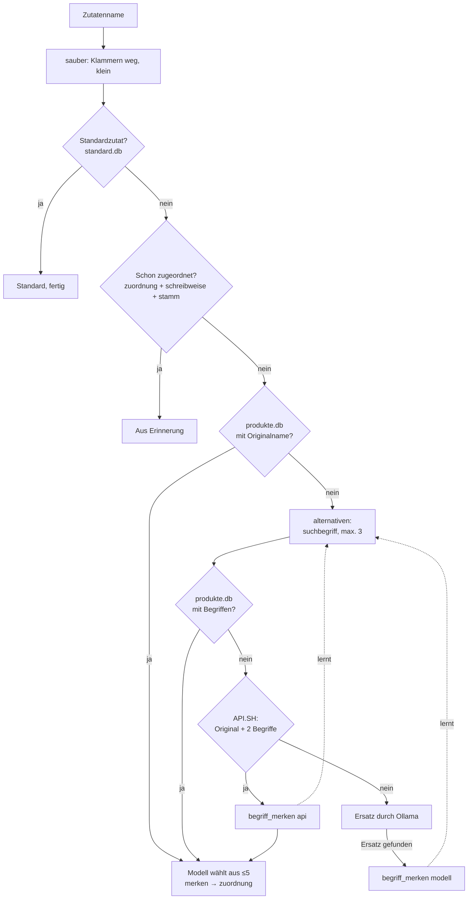

# Recipe-to-REWE (lokal, privat, 0 €)

## Starten
1. Python 3 und Ollama installieren, ein Modell laden (`ollama pull <Modellname>`), Ollama starten. Kontextlänge in Ollama mindestens 8k.
2. Optional (Marktsuche, Produktzuordnung = Stufe 2): Konto bei https://app.api.sh/signup, API-Schlüssel erzeugen. Laut Anbieter gibt es monatlich 1.000 kostenlose Credits.
   **Kein Zahlungsmittel hinterlegen**, nichts aufladen, Ausgabenobergrenze („Spend limits“) auf 0 setzen, falls angeboten.
3. `.env.example` in `.env` umbenennen (Windows: Dateiendungen einblenden), Schlüssel eintragen: `APISH_KEY=dein-schluessel`. Nie weitergeben.
4. `python start.py` ausführen und http://127.0.0.1:8000 öffnen. (`python start.py --ohne-neustart` oder `python server.py` starten ohne Neustart-Automatik.)

## Aufbau: warum kleine Änderungen nur eine Datei betreffen
```
start.py        startet den Server und startet ihn bei Änderungen an den Python-Dateien automatisch neu
server.py       Einstiegspunkt
rtr/            Programmlogik in kleinen Modulen
  config.py       Pfade, Einstellungen, API-Schlüssel
  protokoll.py    Protokoll für /status
  modell.py       lokales Modell (Ollama): Datenstrom, Geduld, Fehlermeldungen
  rezept.py       Rezept auslesen, Mengen, Ersatz, Links zum Ersatz
  apish.py        API.SH: Marktsuche, Produktsuche, Produktdetails
  standard.py     Standardzutaten (standard.db)
  woerter.py      Wortdatenbank (woerter.db): Schreibweisen, Suchbegriffe, Zutat → Produkt
  rezepte.py      Rezeptdatenbank (rezepte.db): fertige Rezepte speichern, auflisten, löschen
  metadaten.py    Metadaten (metadaten.db): Credits, Ollama-Anfragen, Rezeptläufe, Weg je Zutat, Ersatz
  datenbank.py    SQLite-Datenbank, Standardzutaten, Datenbankseite, CSV
  hellofresh.py   HelloFresh-Seite laden
  web.py          Webserver mit allen Routen
prompts/        Anweisungen an das Modell als Textdateien (extrahieren, ersatz, auswahl)
static/         Seiten: je Seite .html, .css und .js (index = Hauptseite, status, datenbank, rezepte, metadaten)
```
Was wann gilt, ohne alles neu zu laden:
- **Seiten** (`static/`) und **Prompts** (`prompts/`) werden bei jedem Aufruf neu gelesen: Datei tauschen, Browser-Seite neu laden. Kein Neustart.
- **Python-Dateien** (`rtr/*.py`): mit `python start.py` erkennt das Programm die Änderung und startet den Server selbst neu. Ist eine Datei kaputt, wartet es,
  bis sie repariert ist. Die Seiten zeigen dann unten einen Hinweis „Neue Programmversion verfügbar“ mit Button zum Neuladen (die Seite lädt nicht von selbst neu, damit nichts verloren geht).
- **Einstellungen** (`settings.json`) und der **API-Schlüssel** (`.env`) gelten sofort.
- **Daten** (`produkte.db`, `woerter.db`, `metadaten.db`, `rezepte.db`, `settings.json`, `.env`, `credits.json`, `cache.json`) liegen im Programmordner und werden von Updates nie überschrieben.

### Updates einspielen
Künftig genügt es, nur die genannten Dateien in den Ordner zu kopieren (gleicher Pfad, z. B. `static/index.js` oder `rtr/rezept.py`), alles andere bleibt.
**Einmalige Umstellung** von der alten Version: das Zip in einen neuen Ordner entpacken und aus dem alten Ordner `.env`, `settings.json`, `produkte.db`,
`credits.json` und `cache.json` mitnehmen. Die alten `index.html`, `status.html` und `datenbank.html` im Hauptordner werden nicht mehr gebraucht.

## Seiten
- `/` Hauptseite: Markt wählen, Rezept laden, prüfen, Ersatz, fertiges Rezept, in der Rezeptdatenbank speichern.
- `/rezepte` Gespeicherte Rezepte: ansehen, drucken, löschen.
- `/metadaten` Nutzung und Dauer: Auswertung der Metadaten (siehe unten).
- `/status` Prozessanzeige: Prüfliste, jeder Schritt live (bei API.SH die genaue Abfrage, Ergebnis und Credits), Zusammenfassung am Ende, Tests für Ollama und API.SH.
  „API.SH …“ = echter Aufruf (kann Credits kosten), „Programm: …“ = interner Schritt (nie Credits), „Datenbank“ = lokal und kostenlos.
- `/datenbank` Gesamte Datenbank: Produkte (Bild, Marke, Packung, Kategorien, Suchbegriffe), Suchbegriffe mit Gültigkeit, Standardzutaten; CSV-Export.

## Benutzung
- **Markt:** Mit Schlüssel Postleitzahl oder Ort suchen und anklicken, sonst Freitext. Ohne Markt startet die Verarbeitung nicht.
- **Rezept:** HelloFresh-URL laden (über die eingebetteten Rezeptdaten, klappt nicht immer) oder Text einfügen, „Rezept verarbeiten“, prüfen, „Rezept erstellen“.
- **Stufe 2** (Haken): Je Zutat wird zuerst die Datenbank gefragt, sonst API.SH. Das Modell wählt aus höchstens 5 Treffern; Bilder lädt dein Browser direkt von REWE.
  Das zeigt das Online-Sortiment, nicht den Bestand im Markt, und keine Preise.
- **Kein passendes Produkt:** Die Zutat wird automatisch zum Ersatz markiert (änderbar). Bei Gewürzmischungen schlägt das Modell eine Mischung aus Einzelgewürzen mit Mengen vor.
  Ersatz und Einzelgewürze bekommen Links. Schlägt ein Ersatz fehl, steht der Grund da und ein Button „Erneut versuchen“.
- **Mengen** werden aus der Originalzeile gelesen (z. B. „1 1/2 EL Öl“), nicht vom Modell.

## Produktdatenbank
`produkte.db` (SQLite) speichert alle gelieferten Produkte mit Name, Link, Bild und den Suchbegriffen, über die sie gefunden wurden; für zugeordnete Produkte zusätzlich Marke,
Packungsgröße und Kategorien (über /product, 1 Credit, danach aus der Datenbank). Einträge gelten 90 Tage. Preise werden nicht gespeichert.
Standardzutaten (Wasser, Salz, Pfeffer, Zucker, Öl, auch „Speisesalz“ usw.) liegen mit eingebettetem Bild in der eigenen Datei `standard.db`, werden nie gesucht und kosten nichts.
Löschst du `produkte.db`, baut sie sich neu auf.

## Reihenfolge der Abfragen je Zutat
1. **Standardzutaten** (`standard.db`): Wasser, Salz, Pfeffer, Zucker, Öl mit Bild. Treffer = fertig, nichts wird gesucht.
2. Gemerktes Produkt (`woerter.db`, Tabelle zuordnung): Auswahl aus früheren Läufen, deine Auswahl vor der des Modells.
3. **Produktdatenbank** (`produkte.db`) mit dem ursprünglichen Namen.
4. Keine Treffer: **Wortdatenbank** (`woerter.db`, Tabelle suchbegriff) übersetzt den Namen in andere Begriffe (Hähnchenbrustfilet → Hähnchenbrust, Hähnchen, Huhn).
5. Produktdatenbank noch einmal mit den neuen Begriffen.
6. Erst dann **API.SH** (Original, dann bis zu zwei übersetzte Begriffe; ein Begriff mit gültigem Eintrag ohne Treffer wird nicht erneut bezahlt). Ein Treffer über einen übersetzten Begriff wird als Übersetzung gelernt.
7. Nichts gefunden: Die Zutat wird zum Ersatz markiert, Ollama schlägt ihn vor.
Bei jedem Treffer wählt das Modell aus höchstens 5 Kandidaten.

### Ablauf der Zutaten-Übersetzung

Gelernt wird an drei Stellen: Ein API-Treffer über einen übersetzten Begriff und ein Ersatz mit Treffer landen in der Tabelle `suchbegriff`
(gelernte Begriffe stehen vor der Startliste), jede Produktwahl landet in `zuordnung` (deine Auswahl vor der des Modells).

## Wortdatenbank
`woerter.db` (eigene SQLite-Datei) lernt Zusammenhänge, damit passende Produkte schneller gefunden werden:
- **Zutat → gewähltes Produkt:** Wählt das Modell ein Produkt oder änderst du es in Schritt 2, wird es gemerkt. Deine Auswahl hat Vorrang und wird vom Modell nie überschrieben.
- **Ähnliche Schreibweisen:** Zwiebeln = Zwiebel (Regel), Hähnchenbrust = Hähnchenbrustfilet (gleiches Produkt).
- **Übersetzungen (Alternative Suchbegriffe):** Eine kleine Startliste ist eingebaut. Außerdem: Führte ein Ersatz (z. B. Taco-Gewürz → Taco Gewürzmischung) zu einem Treffer, wird er beim nächsten Mal zuerst gesucht.
Bekannte Zutaten werden in Schritt 2 sofort übernommen und mit „aus Erinnerung“ gekennzeichnet (änderbar), ohne Modell und ohne API-Anfrage. Ansehen und Einträge vergessen: `/datenbank`, Reiter „Wortdatenbank“.
Löschst du `woerter.db`, ist alles Gelernte weg; sie baut sich neu auf.

## Rezeptdatenbank
Unter dem fertigen Rezept speichert **„In Rezeptdatenbank speichern“** das Rezept in `rezepte.db` (eigene SQLite-Datei). Danach heißt der Button
„Gespeicherte Fassung aktualisieren“: Änderst du noch etwas (z. B. „Erneut versuchen“ beim Ersatz), wird derselbe Eintrag überschrieben statt ein zweiter angelegt.
Ein neu verarbeitetes Rezept bekommt beim Speichern einen neuen Eintrag.

Gespeichert werden je Rezept:
- **Daten (JSON):** Name, Portionen, Markt, Stand der Produktzuordnung, offene Punkte, je Zutat Menge, Name, Originalzeile, Status (Produkt zugeordnet, Ersatz,
  Standardzutat, Im Markt prüfen, Übernommen), Produkt (Name, Link, Bild, Marke, Packung), Mischung und Begründung beim Ersatz, je Schritt Text und Ersatz-Hinweise.
- **Ansicht (HTML):** das fertige Rezept, wie es auf der Seite steht (ohne Buttons), damit es später genauso gezeigt werden kann.
- **Kennzahlen:** Anzahl Zutaten, Ersatz und offene Punkte, Rezeptlauf (Verbindung zu `metadaten.db`), erstellt und geändert.

**Seite `/rezepte`:** Liste aller gespeicherten Rezepte (filterbar nach Name oder Markt, mit Anzahl Zutaten, Ersatz und offenen Punkten), Ansicht wie beim Erstellen,
Drucken / als PDF speichern und Löschen (mit Rückfrage). `/rezepte#3` öffnet direkt Rezept Nr. 3; nach dem Speichern führt der Link „Ansehen“ dorthin.
Als JSON: `/api/rezepte` (Liste), `/api/rezept?id=1` (ein Rezept mit Daten und Ansicht).

## Restzeit
Während „Rezept verarbeiten“, „Rezept erstellen“ und „Erneut versuchen“ zeigt die Hauptseite unten rechts ein schwebendes Fenster, das beim Scrollen
immer sichtbar bleibt: Restzeit (zählt jede Sekunde herunter), aktueller Schritt (z. B. „Produktsuche 3 von 8“), Fortschrittsbalken, bisherige Dauer.
Grundlage ist die typische Dauer (Median der letzten 30 Messungen in `metadaten.db`) für Extrahieren (je Modell), Produktsuche je Zutat und Ersatz.
Restzeit = Extrahieren + Zutaten × Produktsuche bzw. offene Ersatzvorschläge × Ersatz. Nach jedem fertigen Schritt wird neu gerechnet, nach dem Extrahieren
mit der echten Zutatenzahl. Ohne Messungen gelten grobe Startwerte (60 s Extrahieren, 8 s je Zutat, 30 s je Ersatz); mit jeder Nutzung wird die Schätzung genauer.
Als JSON: `/api/schaetzung`.

**Benachrichtigung, wenn etwas fertig ist:** Nach „Rezept übersetzt“, „Rezept erstellt“ und einem erneuten Ersatz erscheint unten rechts eine Meldung mit
Ergebnis (z. B. „7 Zutaten: 5 zugeordnet, 2 für Ersatz markiert“); Klick darauf springt zum Ergebnis, × schließt sie. Ist der Tab im Hintergrund,
steht zusätzlich ✓ (oder ⚠ bei Problemen) im Tab-Titel und, wenn du es beim ersten Start erlaubt hast, kommt eine Mitteilung des Browsers bzw. von Windows.
Erlaubnis ändern: im Browser über das Schloss-Symbol links neben der Adresse → Benachrichtigungen.
Dazu spielt ein kurzer Ton (aufsteigend = fertig, absteigend = bitte prüfen), auch wenn der Tab im Hintergrund ist. Abschalten: Haken „Ton, wenn etwas fertig ist“
in den Einstellungen der Hauptseite (gespeichert in `settings.json` als `ton`).

## Metadaten
`metadaten.db` (eigene SQLite-Datei) sammelt Kennzahlen zur Nutzung. Gespeichert werden nur Zahlen, Namen und Fehlermeldungen, keine Prompts, Antworten oder Rezepttexte.
Ein Fehler beim Schreiben hält das Programm nie an.

**Seite `/metadaten` („Nutzung und Dauer“)**, Zeitraum 7, 30, 90 Tage oder alles, aktualisiert sich alle 30 Sekunden:
- Kennzahlen: Rezeptläufe, Dauer je Rezept (Median, Ø, längster), Credits im Zeitraum und im Monat, **Prognose bis Monatsende** gegen das Limit,
  Anteil der Zutaten ohne API-Kosten, Modellanfragen (Median, Tokens/s, Rechenzeit gesamt), Erfolgsquote beim Ersatz.
- **Hinweise**, die sich aus den Zahlen ergeben: Prognose über dem Limit, Modell wird oft neu geladen (Tipp `OLLAMA_KEEP_ALIVE`), viele Fehler oder zweite Versuche,
  veraltetes Ollama ohne JSON-Schema, Zutaten ohne Treffer, viele unsichere Ersatzvorschläge.
- Diagramme: typische Dauer je Schritt (Ollama je Aufgabe und Modell, API.SH je Endpunkt), wie Zutaten gefunden werden (Stufen), **Zutaten ohne API-Kosten im Verlauf**
  (Anteil je Rezeptlauf, Linie = Durchschnitt der letzten 5 Läufe, Vergleich erste/zweite Hälfte: zeigt, wie die Datenbanken dazulernen), Credits pro Tag. Details im Tooltip.
- Tabellen: Ollama und API.SH im Detail (Median, 90 % unter, längste, Ladezeit, Tokens, Fehler), Zutaten ohne Treffer, langsamste Produktsuchen,
  Gründe fehlgeschlagener Ersatzvorschläge, die letzten 40 Abfragen mit Dauer (filterbar nach Ollama, API.SH, Zutaten).

Als JSON: `/api/metadaten/seite?tage=30` (alles für die Seite) und `/api/metadaten?tage=30` (kurze Zusammenfassung).

| Tabelle | Eine Zeile je | Felder |
|---|---|---|
| `api` | API.SH-Anfrage | Endpunkt, Suchbegriff bzw. Produkt-ID, Credits, Cache (`neu`, `lokal`, `api`), Dauer in ms, Trefferzahl, Fehler |
| `ollama` | Modellanfrage | Modell, Aufgabe (`extrahieren`, `ersatz`, `auswahl`, `test`), Dauer, Ladezeit, Tokens ein/aus, Tokens pro Sekunde, Versuche, Ausweichen auf einfaches JSON, Fehler |
| `rezept` | Rezeptlauf | Start, Ende (Gesamtdauer = Ende − Start), Quelle (`hellofresh` oder `text`), Anzahl Zutaten, Schritte, Warnungen, Dauer des Extrahierens, Fehler, gesuchte Zutaten und davon ohne API-Kosten (Standard, Grundzutat, Erinnerung, Produktdatenbank, Übersetzung) |
| `zutat` | Produktsuche | Rezeptlauf, Zweck (`zutat`, `ersatz`, `mischung`), Zutat, Stufe (`standard`, `grund`, `erinnerung`, `db`, `uebersetzung`, `api`, `api_uebersetzung`, `keine`, `fehler`), genutzter Begriff, Kandidaten, Produkt gewählt, Dauer |
| `ersatz` | Ersatzvorschlag | Rezeptlauf, Zutat, gelungen, unsicher, Gewürzmischung, Versuche, Grund bei Fehlschlag, Dauer |

Löschst du `metadaten.db`, beginnt die Sammlung von vorn. Eine ältere `metadaten.db` ohne die Spalten für „ohne API-Kosten“ wird beim nächsten Start ergänzt und aus den gespeicherten Zutaten nachgerechnet.

## Einstellungen (`settings.json`)
| Schlüssel | Bedeutung | Standard |
|---|---|---|
| `modell` | gewähltes Ollama-Modell (auch auf der Hauptseite wählbar) | – |
| `stufe2` | Produktsuche über API.SH | an |
| `limit` | Credits pro Monat, ab denen Stufe 2 pausiert | 800 |
| `gueltig_tage` | wie lange Datenbankeinträge gelten | 90 |
| `details_auto` | Marke/Packung/Kategorien beim Zuordnen laden (1 Credit je Produkt) | an |
| `timeout_s` | längste Pause ohne neues Zeichen vom Modell | 300 |
| `max_s` | Höchstdauer einer Modellanfrage | 1800 |
| `ton` | Ton, wenn ein Schritt fertig ist | an |
| `grund` | weitere Zutaten, die nie gesucht werden | Salz, Pfeffer, Wasser, Öl, Zucker |

## Wenn das Modell Fehler meldet
Die Meldung nennt die Ursache: Zeitüberschreitung (siehe `timeout_s`/`max_s`; läuft das Modell nur auf dem Prozessor, ist vor allem die erste Anfrage langsam), Modell nicht
installiert (`ollama list`), zu wenig Arbeitsspeicher, Ollama nicht erreichbar oder ungültige Antwort. Ollama-Versionen vor 0.5 kennen kein JSON-Schema; das Programm weicht dann auf einfaches JSON aus.
Auf der Hauptseite und auf /status siehst du live, wie lange das Modell schon läuft und wie viele Zeichen es erzeugt hat.

## Credits
Marktsuche 1, Produktsuche 1 je neuer Zutat, Details 1 je neu zugeordnetem Produkt. Bekannte Zutaten kommen aus der Datenbank, Märkte werden 7 Tage zwischengespeichert.
Bei Erreichen von `limit`, ohne Schlüssel oder bei Fehlern läuft Stufe 1 (ohne API) weiter.

## Hinweise
- Der Schlüssel liegt nur in `.env` und geht nie an den Browser. An API.SH gehen nur Suchbegriffe, Postleitzahl, Produkt- und Markt-IDs, nie der Rezepttext.
- API.SH ist ein Drittanbieter, der öffentliche rewe.de-Daten bereitstellt. Bedingungen von API.SH und REWE vor dauerhafter Nutzung prüfen.
- Nicht umgesetzt: Wochenangebote, eigene Produktliste.
